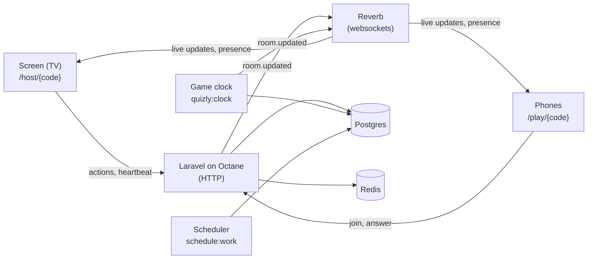
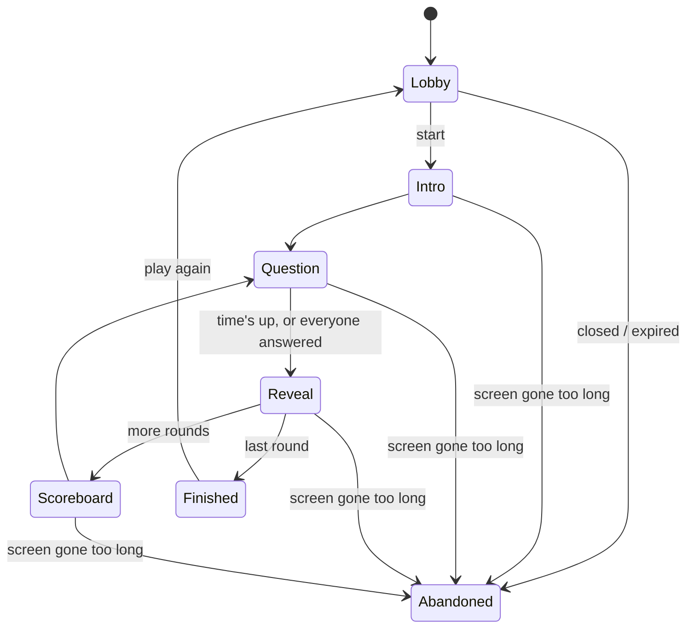

# Quizly

A party trivia game in the style of Jackbox. A shared screen (a TV or a
laptop) hosts a room. Everyone joins from their phone with the room code or
QR code and a nickname, with no accounts. Players answer timed questions on
their phones, faster correct answers score more, and the screen shows the
winner and the full ranking at the end.

Questions come in **Greek** (the main language) and **English**.

- [Features](#features)
- [How it works](#how-it-works)
- [Tech stack](#tech-stack)
- [Project structure](#project-structure)
- [Local setup](#local-setup)
- [Everyday commands](#everyday-commands)
- [Configuration](#configuration)
- [Deployment](#deployment)
- [Troubleshooting](#troubleshooting)

## Features

- **Rooms with a code and QR code.** The screen creates a room, and players
  join at `/play` with a nickname: 2–12 players, no sign-up.
- **Game settings:** language, categories, number of rounds (1–30), time per
  question (5–60 s) and maximum players. The host sets them on the screen.
  The **VIP**, the first player to join, can also set them from their phone,
  and both stay in sync.
- **Speed scoring.** A correct answer is worth 1000 points if it's instant,
  dropping linearly to 500 at the buzzer. Response times are measured on the
  server, so a slow phone or a fast clock doesn't matter.
- **Rounds:** intro, question, reveal (with what everyone picked), then a
  scoreboard between rounds, and final results with a podium.
- **Play again** with the same players and new settings. A room never asks
  the same question twice.
- **Resilience:**
  - Phones and the screen reconnect and catch up on their own.
  - Players whose phones drop out of the lobby are removed after a grace
    period.
  - If the screen disconnects mid-game, the game pauses. If the screen
    doesn't come back within 2 minutes, the room closes.
- **About 6,600 questions** in 11 categories, generated from
  [Wikidata](https://www.wikidata.org) and kept as JSON files in the repo.
- **Language picker** on the start and join pages. Inside a room, the room's
  language applies.
- **Sound.** The screen plays music and sound effects. Phones play each
  player's own sounds (their answer going in, right or wrong, the finish) and
  vibrate where supported. All sound is synthesized in the browser; there are
  no audio files.

## How it works

### The pieces



- **The web app** (Laravel on Octane/Swoole) serves the pages (Inertia + Vue)
  and handles every action: create, join, change settings, start, answer,
  skip, play again, kick, close.
- **Reverb** pushes live updates to the screen and the phones over one
  presence channel per room, `presence-room.{code}`. Presence also tells the
  screen who is connected.
- **The game clock** (`php artisan quizly:clock`) is a long-running process
  that moves games along on time. More below.
- **The scheduler** handles housekeeping. Every minute it closes expired rooms
  and lobbies nobody joined; every day it deletes games older than 7 days.
- **Postgres** stores rooms, players, rounds, answers and questions.
  **Redis** holds sessions and the cache.

### Hosts and players without accounts

The screen and the players are identified by cookies with a random token. Only
the token's hash is stored. There are two cookies:

| Cookie | Scoped to | Identifies |
| --- | --- | --- |
| `quizly_host` | `/host` | the screen running a room |
| `quizly_player` | `/play` | a player in a room |

Each cookie has its own auth guard (`host`, `player`) and its own channel
authorization endpoint (`/host/broadcasting/auth`, `/play/broadcasting/auth`).
Because the cookies are scoped to different paths, one browser can be the
host in one tab and a player in another.

The first player to join is the **VIP**. The VIP can change the settings and
start the game from their phone. If the VIP leaves, the role passes to the
next player.

### One snapshot, always the newest

Every change sends a `room.updated` broadcast (`App\Events\RoomUpdated`)
carrying the **whole room state** (`App\Support\RoomState`): status, players,
settings, the current round, standings, the next deadline, and the server's
clock. Each snapshot has a version number. Clients keep the newest one and
ignore any that arrive out of order.

Broadcasts can go missing, for example while a phone sleeps, so the client
(`resources/js/composables/useRoom.ts`) also fetches the state again:

- after reconnecting;
- when the tab becomes visible;
- when a phase is overdue;
- after 30 s without any update.

Countdowns run on server time: the client keeps track of the offset between
its clock and the server's.

### The game loop



`App\Game\GameEngine` is the state machine. Each timed phase stores when it
ends (`next_transition_at`).

The game clock checks every 100 ms for games that are due and advances them:

- Each game advances in its own transaction, using
  `SELECT … FOR UPDATE SKIP LOCKED`. Several clocks can run at once and share
  the work, so a rolling deploy is safe.
- A game that fails three times in a row is abandoned, so it can't block the
  others.
- If the database goes away, the clock backs off and keeps trying.

Phase lengths (from `config/quizly.php`):

| Phase | Length |
| --- | --- |
| Intro | 4 s |
| Reading time before answers open | 3 s |
| Answering | the room's time per question |
| Reveal | 6 s |
| Scoreboard | 5 s |

A question ends early once every connected player has answered. The host can
also skip a phase.

**Picking questions** (`App\Game\QuestionPicker`): the picker draws a random
selected category first, then a random question from it. That way a big
category doesn't crowd out the small ones. A question already used in the
room, including in earlier games, is never picked again.

**Scoring** (`App\Game\ScoreCalculator`, `App\Game\Standings`): response time
is measured on the server, from the moment answers open
(`CaptureRequestTime` middleware). Points are only added at the reveal.
Players with the same score are ranked by the total time of their correct
answers.

### When the screen goes away

The screen sends a heartbeat every 5 s. If the clock hasn't heard from it for
10 s during a game, the game **pauses**, and the phones show a countdown.
When the screen comes back, the game resumes and the current round's times
shift by the length of the pause. If the screen is gone for **2 minutes**,
the room closes.

In the lobby, the screen watches who is connected. A player whose phone has
been gone for 20 s is removed, which frees the slot and passes the VIP role
on. Before removing anyone, the server checks with Reverb that they really
are gone. A short drop, such as a page reload, is ignored.

### Play again

A finished room can go back to the lobby with the same players. Scores reset
and the settings can change. Each game in a room has a `match_number`, so
round numbers restart and old answers are never confused with new ones. The
room code stays reserved for an hour after a game ends, so new rooms don't
take it.

### Questions

Questions live in `database/data/questions/`:

- `starter.json`: hand-written questions;
- `wikidata/{category}.json`: generated by
  `php artisan quizly:generate-wikidata-questions`.

The generator runs SPARQL templates per category (`app/Content/Wikidata/`),
for example capitals, chemical elements, film directors, Eurovision winners
or Greek battles. It writes the question text in Greek and English. Each
question gets three wrong answers, drawn from similar answers or nearby
years. Difficulty is set by how well known the subject is. The output is
deterministic, so running it again only changes what changed on Wikidata.

`QuestionSeeder` imports every file. Running it again updates existing
questions instead of duplicating them. In production,
`php artisan quizly:seed-content` runs on every start, but only imports when
the files have changed.

### Languages

The UI strings are in `lang/el.json`; English is the source text.

Inside a room, everything follows the room's language, which the host or the
VIP sets. Elsewhere, the language comes from:

1. the language picker (the `quizly_locale` cookie);
2. otherwise, the browser's preferred language;
3. otherwise, Greek.

### Sound

`resources/js/lib/sound.ts` synthesizes every sound with the Web Audio API.
`resources/js/composables/useGameSounds.ts` connects sounds to game events:

- **The screen** plays the soundtrack: lobby music, a "thinking" loop while
  players answer, the countdown ticks, the reveal, the fanfare, and so on.
- **Phones** play only each player's own sounds, so a room full of phones
  doesn't play the same sound slightly out of sync. Players can mute their
  phone.

Browsers keep a page silent until someone interacts with it. After the
screen reloads, it shows a hint to click once.

## Tech stack

| Part | Choice |
| --- | --- |
| Backend | PHP 8.5, Laravel 13, Laravel Octane (Swoole) |
| Live updates | Laravel Reverb, Laravel Echo (`@laravel/echo-vue`) |
| Frontend | Inertia v3, Vue 3, TypeScript, Tailwind CSS v4, shadcn-vue, Lucide icons, VueUse |
| Routes in TypeScript | Laravel Wayfinder |
| Build tooling | Vite+ (`vp`: build, lint, format) |
| Data | PostgreSQL 18, Redis |
| Local environment | Laravel Sail (Docker) |
| Tests | Pest |

The project started from the Laravel Vue starter kit, so it also contains the
kit's user accounts, dashboard and settings pages (Fortify). The game itself
doesn't use them, so they're switched off: their routes answer 404 unless
`QUIZLY_ACCOUNTS_ENABLED=true` (see `App\Http\Middleware\EnsureAccountsEnabled`).

## Project structure

```
app/
├── Actions/Rooms/        create, join, settings, start, play again, kick, close…
├── Actions/Game/         submitting an answer
├── Actions/Questions/    importing questions from JSON
├── Content/              Wikidata question generator and question files
├── Console/Commands/     quizly:clock, quizly:expire-rooms, quizly:seed-content,
│                         quizly:generate-wikidata-questions, quizly:import-questions
├── Events/RoomUpdated.php   the one broadcast: the room's full state
├── Game/                 GameEngine (state machine), QuestionPicker, ScoreCalculator,
│                         Standings, RoomPresence (asks Reverb who's connected)
├── Http/Controllers/Rooms/  HostRoomController (the screen), PlayController (phones)
├── Models/               Game (a room), Player, Round, Answer, Question, Category…
└── Support/RoomState.php    builds the room snapshot sent to clients
config/quizly.php         game settings: limits, timings, scoring, host timeouts…
database/data/questions/  the question files
docker/                   production image: entrypoint, supervisord, php.ini
deploy/COOLIFY.md         production deployment guide
lang/el.json              Greek UI strings
resources/js/
├── pages/host/Room.vue   the screen
├── pages/play/           joining and playing on a phone
├── components/game/      question, reveal, scoreboard and final screens
├── components/room/      lobby pieces: settings, player cards, QR code, sound
├── composables/useRoom.ts       live room state, presence and resyncs
├── composables/useGameSounds.ts game events → sounds
└── lib/sound.ts          the synthesizer: effects and music
routes/web.php            /host/… and /play/… routes
tests/Feature/            game loop, rooms, resilience, questions, locale…
```

## Local setup

Everything runs in Docker through [Laravel Sail](https://laravel.com/docs/sail):
the app on Octane, Reverb, the game clock, the scheduler, Postgres and Redis.
You don't need PHP or Node on your machine.

### Requirements

- Docker Desktop (or Docker Engine with Compose)
- Git

### 1. Get the code and install the PHP packages

```bash
git clone git@github.com:JakeLap/quizly.git
```

```bash
cd quizly
```

```bash
cp .env.example .env
```

Without PHP on your machine, install the Composer packages with a throwaway
container:

```bash
docker run --rm -u "$(id -u):$(id -g)" -v "$(pwd):/var/www/html" -w /var/www/html laravelsail/php84-composer:latest composer install --ignore-platform-reqs
```

If you do have PHP and Composer, `composer install` does the same.

### 2. Start the containers

```bash
./vendor/bin/sail up -d
```

The first run builds the Sail image, which takes a few minutes. Tip: add
`alias sail='sh $([ -f sail ] && echo sail || echo vendor/bin/sail)'` to your
shell profile so you can type `sail` instead of `./vendor/bin/sail`.

The commands below assume that alias.

| Container | What it runs | Port on your machine |
| --- | --- | --- |
| `laravel.test` | Octane (Swoole), reloading on code changes | 8000 |
| `reverb` | the websocket server | 8080 |
| `clock` | the game clock | |
| `scheduler` | the scheduler | |
| `pgsql` | Postgres 18 | 5432 |
| `redis` | Redis | 6379 |

### 3. Install, configure and seed

```bash
sail npm ci
```

```bash
sail artisan key:generate
```

```bash
sail artisan migrate --seed
```

The seed creates the categories and imports all the questions, which takes
about half a minute. It also creates the starter kit's test user
(`test@example.com` / `password`), which the game doesn't need; accounts are
switched off unless `QUIZLY_ACCOUNTS_ENABLED=true`.

```bash
sail npm run build
```

Octane only starts reloading on code changes once the npm packages are
installed, so restart it once:

```bash
sail restart laravel.test
```

### 4. Play

1. Open <http://localhost:8000> and choose **Create game**. This browser
   window is the screen.
2. Join from a second browser window, or from a phone (see below), at
   <http://localhost:8000/play>.
3. Once two players are in, start the game from the screen or from the VIP's
   phone.

**Playing with real phones on your network.** Open the screen at your
computer's LAN address instead of `localhost`, for example
`http://192.168.1.20:8000`. The QR code and join link use whatever address
the screen was opened at, and phones connect to Reverb on the same host,
port 8080. Your computer's firewall must allow ports 8000 and 8080.

### Front-end development

For hot reloading while you edit Vue or CSS:

```bash
sail npm run dev
```

The Vite dev server runs on port 5173 inside the container. PHP changes are
picked up by Octane's file watcher. Stop the dev server (or run
`sail npm run build`) before testing from phones on your network.

## Everyday commands

| Task | Command |
| --- | --- |
| Run the tests | `sail artisan test` |
| Run one test file | `sail artisan test tests/Feature/Game/GameLoopTest.php` |
| PHP code style (fix) | `sail bin pint` |
| PHP static analysis | `sail composer types:check` |
| JS/TS lint and format check | `sail npm run check` (`check:fix` to fix) |
| TypeScript types | `sail npm run types:check` |
| Everything CI runs | `sail composer ci:check` |
| Regenerate typed routes after adding a route | `sail artisan wayfinder:generate --with-form` |
| Regenerate questions from Wikidata | `sail artisan quizly:generate-wikidata-questions` (`--category=…`, `--template=…`, `--dry-run`) |
| Import the question files | `sail artisan db:seed --class=QuestionSeeder` |
| Import a JSON file of questions | `sail artisan quizly:import-questions path/to/file.json --publish` |
| Watch the game clock's output | `sail logs -f clock` |

After regenerating questions, review the changes in
`database/data/questions/wikidata/`, then import them with the seeder. Use
`config/quizly.php → wikidata.exclude` to drop questions where Wikidata is
wrong.

## Configuration

Game behaviour is in `config/quizly.php`:

| Setting | Default | |
| --- | --- | --- |
| `locales`, `default_locale` | `el`, `en`; `el` | Default via `QUIZLY_DEFAULT_LOCALE` |
| `rounds`, `seconds_per_round`, `players` | 1–30 (10), 5–60 s (20), 2–12 (8) | Limits (and defaults) of the room settings |
| `timing` | intro 4 s, reading 3 s, reveal 6 s, scoreboard 5 s | Plus a 300 ms grace period for answers in flight |
| `scoring` | 1000 → 500 | Points for an instant answer and for one at the buzzer |
| `host.heartbeat_seconds` / `timeout_seconds` / `return_seconds` | 5 / 10 / 120 | Screen heartbeat, pause after, close after |
| `lobby_disconnect_grace_seconds` | 20 | Before a dropped phone leaves the lobby |
| `room_lifetime_minutes` | 180 | Rooms expire after this |
| `results_visible_minutes` | 60 | The final results stay viewable, and the code reserved, for this long |
| `empty_lobby_minutes` | 30 | A lobby nobody joined closes after this |
| `prune_after_days` | 7 | Old games are deleted after this |
| `accounts_enabled` | `false` | The starter kit's login, registration, dashboard and settings pages; off means they answer 404. Set `QUIZLY_ACCOUNTS_ENABLED=true` to turn them on |

Websocket settings in `.env`:

- `REVERB_HOST`, `REVERB_PORT`, `REVERB_SCHEME`: where the app sends
  broadcasts.
- `REVERB_PUBLIC_HOST`, `REVERB_PUBLIC_PORT`, `REVERB_PUBLIC_SCHEME`: where
  browsers connect. These are read at run time, so one build works on any
  domain. An empty host means the page's own host.

## Deployment

Production runs as a single Docker image (`Dockerfile`). By default, one
container runs the site, Reverb, the game clock and the scheduler under
supervisord. On start, it runs the migrations and imports changed questions.
Postgres and Redis are external, set through `DB_URL` and `REDIS_URL`.

For setting it up on Coolify (domains, environment variables, databases),
see [deploy/COOLIFY.md](deploy/COOLIFY.md).

## Troubleshooting

- **Port 8000 (or 8080, 5432, 6379) is already in use.** Change `APP_PORT`,
  `FORWARD_REVERB_PORT`, `FORWARD_DB_PORT` or `FORWARD_REDIS_PORT` in `.env`,
  then run `sail up -d` again.
- **Phones can't join or don't get updates.** Open the screen at your
  computer's LAN address, not `localhost`. Make sure the phones are on the
  same network and the firewall allows ports 8000 and 8080.
- **"Connection lost" on every page.** Check that the `reverb` container is
  running (`sail ps`, `sail logs reverb`).
- **Nothing happens after a question's time runs out.** The game clock isn't
  running. Check `sail logs clock`.
- **The game paused by itself.** The screen's tab was hidden or asleep, and
  browsers slow down timers in background tabs, so its heartbeat stopped.
  Keep the screen's tab visible.
- **No sound on the screen.** Click anywhere on the page once; browsers block
  sound until you interact with the page.
- **Code changes don't show up.** Octane keeps the app in memory. Its watcher
  reloads on PHP changes; if it doesn't, run `sail artisan octane:reload`. For
  front-end changes, run `sail npm run build` or use `sail npm run dev`.
